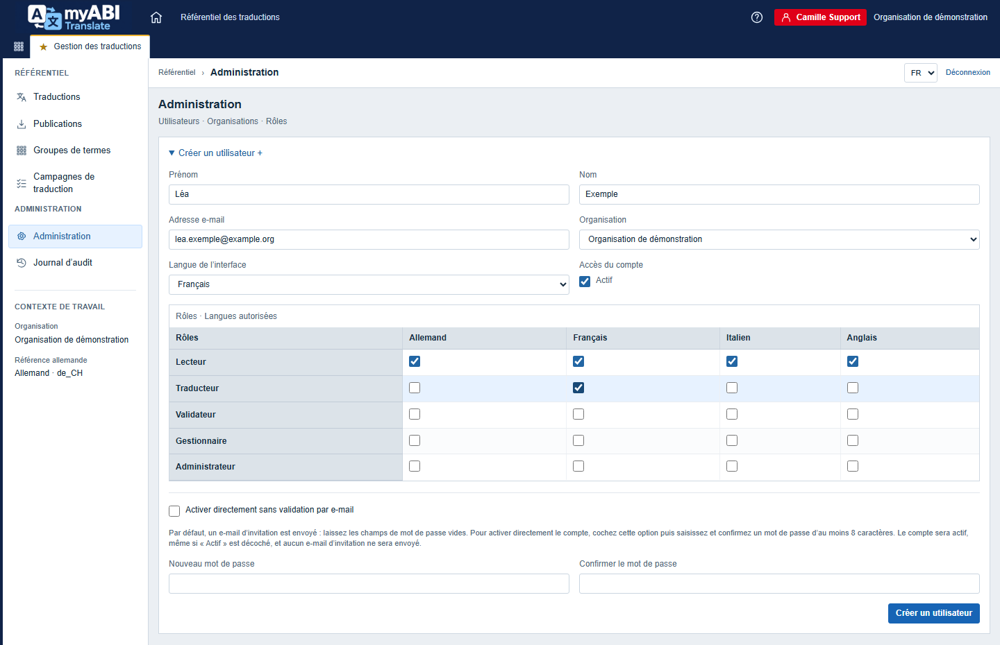
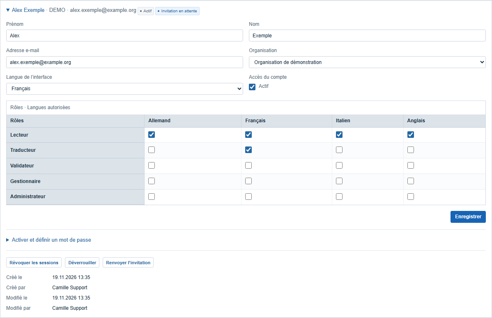
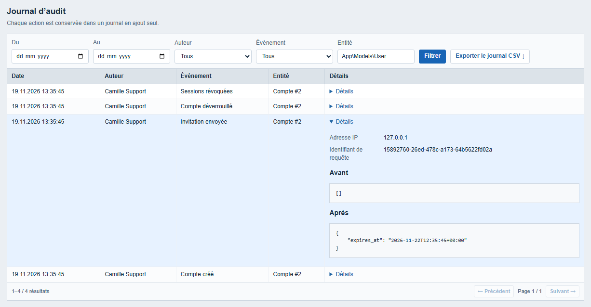

# Manuel d’administration de myabi-translate

Ce manuel s’adresse au support IT chargé des comptes, des organisations et du diagnostic des incidents dans myabi-translate. Les captures présentent des comptes fictifs. Ouvrez l’adresse HTTPS officielle communiquée par votre organisation et sélectionnez **FR** dans **Langue de l’interface** pour retrouver les libellés de ce guide.

Les parcours de recherche, de traduction et de publication sont décrits dans le [manuel utilisateur](../utilisateur/manuel-utilisateur.md).

## 1. Accéder à l’administration et vérifier les droits

1. Connectez-vous avec votre compte nominatif.
2. Si le site vous dirige vers **Mon profil** pour configurer le second facteur, suivez la procédure de la section 4.
3. Dans la barre latérale, ouvrez **Administration**. Si le lien manque, ouvrez **Mon profil** et vérifiez les rôles affichés.

| Rôle | Droits dans l’application |
| --- | --- |
| Lecteur | Consulter le catalogue et télécharger les publications destinées à son organisation. |
| Traducteur | Proposer des traductions dans les langues autorisées pour ce rôle. |
| Validateur | Proposer et décider dans les langues autorisées pour ce rôle. |
| Gestionnaire | Traduire et valider dans toutes les langues. Gérer les groupes, les campagnes, les imports, les exports et les publications. Consulter et exporter le journal d’audit. |
| Administrateur | Gérer les utilisateurs et les organisations. Consulter et exporter le journal d’audit. |

Les rôles se cumulent. La grille **Rôles · Langues autorisées** applique les choix de langue aux droits de traduction et de validation des rôles correspondants. Le Gestionnaire a des droits de traduction et de validation dans les quatre langues, indépendamment des cases cochées sur sa ligne. Le rôle Administrateur donne accès à la gestion des comptes à l’échelle de l’instance. Pour une demande qui concerne un import ou une décision de traduction, sollicitez le Gestionnaire ou le Validateur compétent.

Le catalogue et les traductions validées sont communs aux organisations. L’organisation de rattachement sert notamment à identifier les contributions et à déterminer les publications accessibles.

## 2. Créer et activer un compte

### Envoyer une invitation par e-mail

1. Dans **Administration**, dépliez **Créer un utilisateur**.
2. Saisissez **Prénom**, **Nom** et **Adresse e-mail**, puis sélectionnez l’**Organisation** active et la **Langue de l’interface**.
3. Cochez les rôles et les langues autorisés. Vérifiez que **Actif** est coché et laissez **Activer directement sans validation par e-mail** décoché. Laissez les champs de mot de passe vides.
4. Cliquez sur **Créer un utilisateur**. Retrouvez le compte dans **Utilisateurs** avec son nom ou son adresse e-mail.
5. Demandez à la personne d’ouvrir le lien reçu, de définir son mot de passe et de terminer, si nécessaire, la configuration du second facteur.

Le compte peut afficher à la fois **Actif** et **Invitation en attente**. L’accès par mot de passe s’ouvre après activation. Le lien d’invitation est à usage unique et expire après 72 heures.



Figure 1 — Création d’un compte sur invitation.

### Activer un compte sans e-mail

Identifiez la personne et vérifiez que l’activation est autorisée. Pour un nouveau compte, cochez **Activer directement sans validation par e-mail** dans le formulaire de création, saisissez puis confirmez le mot de passe, et cliquez sur **Créer un utilisateur**. Pour un compte existant, ouvrez sa fiche et dépliez **Activer et définir un mot de passe**. Saisissez et confirmez le nouveau mot de passe, puis lancez l’action. L’écran indique la longueur minimale configurée sur l’instance.

Cette action active le compte dans une organisation active. Sur un compte existant, elle remplace le mot de passe, lève le verrouillage et invalide les sessions, les jetons d’extension existants ainsi que les liens d’invitation et de récupération en cours. Le titulaire utilise toujours son second facteur si celui-ci est confirmé et que le MFA est activé.

Transmettez le mot de passe par le canal sécurisé prévu par votre organisation. Demandez à la personne de le modifier dans **Mon profil** après sa première connexion.

## 3. Modifier, déverrouiller ou désactiver un compte

Dans **Administration**, recherchez la personne par nom ou adresse e-mail, filtrez éventuellement par organisation, puis dépliez sa fiche. Vérifiez l’adresse et l’organisation avant d’agir.

| Demande | Action | Effet |
| --- | --- | --- |
| Corriger l’identité, le rattachement ou les droits | Modifiez les champs ou la grille des rôles, puis cliquez sur **Enregistrer**. | Les droits sont relus à chaque requête. Un changement d’adresse révoque les sessions et invalide les jetons d’extension existants. Si l’invitation est en attente, renvoyez-la à l’adresse corrigée après avoir enregistré. |
| Remplacer une invitation perdue ou expirée | Vérifiez l’adresse, l’état **Actif** et l’organisation. Cliquez sur **Renvoyer l’invitation** et confirmez. | Le dernier lien remplace le précédent. L’action est disponible tant que l’activation est en attente. |
| Lever un verrouillage | Cliquez sur **Déverrouiller** et confirmez après avoir vérifié l’identité et le motif. | Le compteur d’échecs et le verrouillage du compte sont remis à zéro. Après cinq échecs, le verrouillage dure 15 minutes. Une limite de requêtes distincte peut encore imposer un délai. |
| Fermer les accès en cours, par exemple après une perte de poste | Cliquez sur **Révoquer les sessions** et confirmez. | Toutes les sessions web du compte et ses jetons d’extension existants sont invalidés. La personne peut se reconnecter avec ses identifiants. |
| Retirer l’accès, par exemple au départ d’une personne | Décochez **Actif**, puis cliquez sur **Enregistrer**. | L’accès web et l’accès par l’extension sont bloqués. Les contributions et l’identité de leur auteur restent dans l’historique. |

Pour rendre l’accès à un compte désactivé, vérifiez l’autorisation et l’organisation de rattachement, puis cochez **Actif** et enregistrez. Si une invitation attend toujours son acceptation, utilisez **Renvoyer l’invitation**. Si vous devez également définir un nouveau mot de passe, utilisez **Activer et définir un mot de passe**.

L’application protège l’accès du dernier Administrateur actif et activé d’une organisation active. Avant son départ ou la désactivation de son organisation, préparez un autre compte Administrateur et vérifiez qu’il peut ouvrir **Administration**.



Figure 2 — Actions disponibles sur la fiche d’un utilisateur.

## 4. Rétablir l’accès à un compte

### Mot de passe oublié ou lien inutilisable

1. Vérifiez l’adresse enregistrée, l’état du compte et celui de l’organisation. Pour un compte dont l’invitation est en attente, renvoyez l’invitation.
2. Depuis la page de connexion, demandez à la personne d’ouvrir **Mot de passe oublié ?**, de saisir son adresse puis de cliquer sur **Envoyer le lien**.
3. Demandez-lui d’utiliser le lien le plus récent sur l’adresse officielle et de définir un nouveau mot de passe. Le lien est à usage unique et expire après 60 minutes avec le réglage du dépôt.

Le message affiché après la demande est volontairement identique pour une adresse connue ou inconnue. Confirmez la réception avec la personne. Si le courriel est absent, vérifiez les indésirables et l’adresse saisie, puis suivez le diagnostic de la section 8. Une réinitialisation réussie invalide les anciennes sessions et les jetons d’extension existants. Le second facteur est conservé.

### Second facteur, code refusé ou téléphone perdu

Lorsque le MFA est activé sur le serveur, il est obligatoire pour les rôles Validateur, Gestionnaire et Administrateur. Il est facultatif pour les autres comptes. Toute personne qui l’a configuré et confirmé doit présenter un second facteur à la connexion.

1. Pour configurer le second facteur, ouvrez **Mon profil** puis **Authentification à deux facteurs**. Saisissez le mot de passe et cliquez sur **Configurer le second facteur**.
2. Scannez le QR code avec l’application d’authentification, ou saisissez la **Clé de configuration**. Saisissez le **Code à six chiffres**, puis cliquez sur **Confirmer l’activation**.
3. Conservez les codes de récupération dans un emplacement sécurisé. Sur l’écran de connexion, un code de récupération disponible peut remplacer le code de l’application. Chaque code de récupération est à usage unique.

En cas de code refusé, vérifiez que l’heure du téléphone est synchronisée et que la personne utilise l’entrée de la bonne instance. Si elle a perdu son téléphone et tous ses codes, vérifiez son identité et transmettez le dossier au responsable de l’instance. Une activation administrative ou une réinitialisation du mot de passe conserve le second facteur. Le réglage `MFA_ENABLED` s’applique à toute l’instance. Voir la [configuration du MFA](../deploiement/deploiement-vps.md#réglage-global-du-mfa).

Une session peut expirer après 60 minutes sans activité ou 12 heures après la connexion. Si les déconnexions se répètent avant ces délais, vérifiez les actions de révocation et les changements intervenus sur le compte dans le journal d’audit.

## 5. Gérer les organisations

1. Dans **Administration**, descendez jusqu’à **Organisations** et dépliez **Créer une organisation**.
2. Saisissez un **Code** unique de 40 caractères au maximum. Les lettres, chiffres, tirets et tirets bas sont admis. Indiquez le **Nom** et cliquez sur **Créer une organisation**.
3. Vérifiez que l’organisation active apparaît lors de la création ou de la modification d’un compte.

Pour modifier le code, le nom ou l’état, dépliez l’organisation et cliquez sur **Enregistrer** après modification. Si vous décochez **Actif**, les comptes rattachés perdent l’accès à l’application et à l’extension tant que l’organisation est désactivée. Vérifiez les comptes qui pourront retrouver l’accès avant de réactiver l’organisation. L’organisation racine ARGE-ABI reste active.

Vérifiez le rattachement avant de déplacer un compte. Un changement peut modifier les publications accessibles à la personne. En cas de publication manquante, demandez au Gestionnaire de vérifier son état et ses organisations destinataires.

## 6. Consulter le journal d’audit

1. Ouvrez **Journal d’audit** depuis le menu latéral avec un compte Administrateur ou Gestionnaire.
2. Délimitez la recherche avec **Du**, **Au**, **Auteur** ou **Événement**, puis cliquez sur **Filtrer**. Pour une modification de compte, le filtre **Auteur** porte sur l’Administrateur qui a effectué l’action. Le compte modifié figure dans **Entité**. Pour limiter la recherche aux événements liés à des comptes, saisissez `App\Models\User` dans le filtre **Entité**.
3. Ouvrez **Détails** sur l’événement. Relevez la date, l’auteur, le numéro de l’entité et l’**Identifiant de requête** lorsqu’il est utile au diagnostic. Les blocs **Avant** et **Après** montrent les valeurs enregistrées selon l’action.
4. Pour conserver un relevé, appliquez les filtres puis cliquez sur **Exporter le journal CSV**. L’écran utilise l’heure suisse et le CSV indique les horodatages en UTC.



Figure 3 — Événements de support dans le journal d’audit.

Par exemple, recherchez **Rôles modifiés** pour vérifier une attribution de droits et **Mot de passe défini par un administrateur** pour retrouver une activation ou un changement de mot de passe manuel. L’événement **Invitation envoyée** trace l’émission du lien et son échéance. Confirmez la livraison auprès du destinataire ou dans le suivi SMTP.

Le journal est protégé en ajout seul. Conservez les CSV dans le stockage privé autorisé. Dans un ticket, limitez-vous aux identifiants de l’incident et aux extraits nécessaires, expurgés des données personnelles et des valeurs métier. Les [consignes d’exploitation des journaux](../deploiement/operations.md#consulter-les-logs-techniques-et-le-journal-daudit) indiquent où lire les logs Laravel.

## 7. Dépanner l’extension navigateur

Dans les paramètres de **myABI Translation Inspector**, vérifiez le mode **Référentiel réel (contrat v2)**, l’URL HTTPS de l’API se terminant par `/api/browser-extension` et les **Domaines MyAB autorisés**. Cliquez sur **Enregistrer**, acceptez les autorisations du navigateur, puis utilisez **Tester la connexion**. Pour créer ou révoquer un jeton personnel, suivez le [parcours de configuration de l’extension](../utilisateur/manuel-utilisateur.md#configurer-laccès-au-référentiel).

| Symptôme | Vérification |
| --- | --- |
| `401`, authentification refusée | Vérifiez le compte, son organisation et l’état du jeton dans **Mon profil**. Un jeton expiré, révoqué ou invalidé par une révocation de sessions doit être remplacé. |
| `403`, accès refusé | Relevez le message précis. S’il mentionne le second facteur, demandez à la personne de se reconnecter avec son second facteur puis de créer un jeton. S’il mentionne l’origine de l’extension ou ses permissions, relevez le navigateur et la version de l’extension, puis transmettez à l’exploitation. |
| `429`, trop de requêtes | Attendez le délai indiqué avant de tester à nouveau. |
| `503`, service indisponible | Vérifiez si la connexion web fonctionne. Transmettez l’heure et le message à l’exploitation pour contrôler l’activation de l’API et l’index de recherche de l’extension. |
| Le test réussit et l’inspecteur ne s’ouvre pas dans MyAB | Vérifiez le domaine MyAB autorisé, rechargez l’onglet et activez **Mode inspecteur**. |

Le jeton est affiché une seule fois à la création et appartient au titulaire du compte. Si un jeton a été divulgué, son titulaire peut cliquer sur **Révoquer** dans **Mon profil → Extension navigateur**. Avec l’action **Révoquer les sessions**, l’Administrateur peut aussi invalider l’ensemble des jetons et sessions de ce compte. Ne joignez aucun jeton au ticket.

## 8. Diagnostiquer un incident et le transmettre

1. Identifiez les utilisateurs concernés et l’étape en échec. Relevez l’heure suisse, le message exact, le code HTTP éventuel et, si l’application l’affiche, la référence de diagnostic. Pour un import ou une publication, relevez son numéro et son état.
2. Contrôlez l’accès HTTPS et l’ouverture de la page de connexion. Si vous intervenez côté exploitation, contrôlez aussi `/up`, puis la connexion et le parcours concerné avec un compte de test autorisé.
3. Transmettez les éléments dans le canal IT privé. Gardez les mots de passe, jetons, liens d’activation ou de récupération complets, codes MFA, fichiers DEVCONF et logs bruts dans leurs emplacements protégés.

| Symptôme | Contrôles côté support et exploitation |
| --- | --- |
| Site inaccessible ou erreur HTTPS | Vérifiez l’adresse officielle et si plusieurs postes sont touchés. Côté serveur, contrôlez le DNS, le certificat, le frontal et l’état des services. Pour Docker, voir le [guide VPS](../deploiement/deploiement-vps.md#3-raccorder-le-https-existant). |
| Invitation ou réinitialisation non reçue | Vérifiez l’adresse, l’échéance et les indésirables. Côté serveur, contrôlez les erreurs SMTP et, si la file d’envoi est asynchrone, le traitement de la tâche d’invitation. Si le lien reçu pointe vers une ancienne adresse, contrôlez l’URL canonique. Voir [Origine des liens et récupération de compte](../deploiement/security-deployment.md#origine-des-liens-et-récupération-de-compte). |
| Import, publication ou validation en masse en attente | Demandez au Gestionnaire de vérifier l’état et la progression de l’opération. Côté serveur, contrôlez la dernière exécution de `referentiel:work` et la planification de l’instance. Voir [Traitements en arrière-plan](../../README.md#traitements-en-arrière-plan). |
| Import ou publication en échec | Relevez la référence de diagnostic lorsqu’elle est affichée et recherchez-la dans les logs Laravel. Pour un import, le Gestionnaire examine aussi le rapport et les collisions. Une fois la cause corrigée, le Gestionnaire peut utiliser **Réessayer** sur l’opération concernée. L’import repart par l’analyse. Respectez les [règles d’identité des formats DEVCONF](../technique/formats-devconf.md) et conservez l’original dans le stockage privé. |
| Recherche approximative indisponible dans **Traductions** | Décochez **Recherche approximative** pour poursuivre avec la recherche habituelle. Côté serveur, vérifiez l’index du catalogue comme indiqué ci-dessous. |

### Lire l’état des index de recherche

Depuis le répertoire de la version active en installation native, utilisez les commandes de lecture suivantes.

```sh
php artisan referentiel:catalogue-search-status
php artisan referentiel:extension-search-status
```

Avec Docker, depuis le répertoire Compose de l’instance, lancez les mêmes contrôles avec le service CLI.

```sh
docker compose --env-file compose.env run --rm --no-deps -T cli php artisan referentiel:catalogue-search-status --no-interaction
docker compose --env-file compose.env run --rm --no-deps -T cli php artisan referentiel:extension-search-status --no-interaction
```

| Index | Interprétation |
| --- | --- |
| Catalogue, pour **Recherche approximative** | `ready` indique que l’index est exploitable. `not_prepared` indique que les références doivent être initialisées. `unavailable` indique que l’index doit être réparé. Voir la [procédure de reconstruction du catalogue](../deploiement/operations.md#index-du-catalogue-et-recherche-approximative). |
| Extension navigateur | `ready` indique que l’index est exploitable. `disabled` indique que l’API est désactivée. `unavailable` indique qu’il faut vérifier les migrations, les originaux privés et l’index. Voir la [procédure de mise en service de la recherche de l’extension](../deploiement/deploiement-vps.md#5-mettre-en-service-la-recherche-de-lextension). |

L’exploitation planifie une reconstruction sur une plage sans écritures métier. Après la remise en service, contrôlez l’état `ready` et rejouez la recherche concernée, dans **Traductions** ou via **Tester la connexion** dans l’extension.
