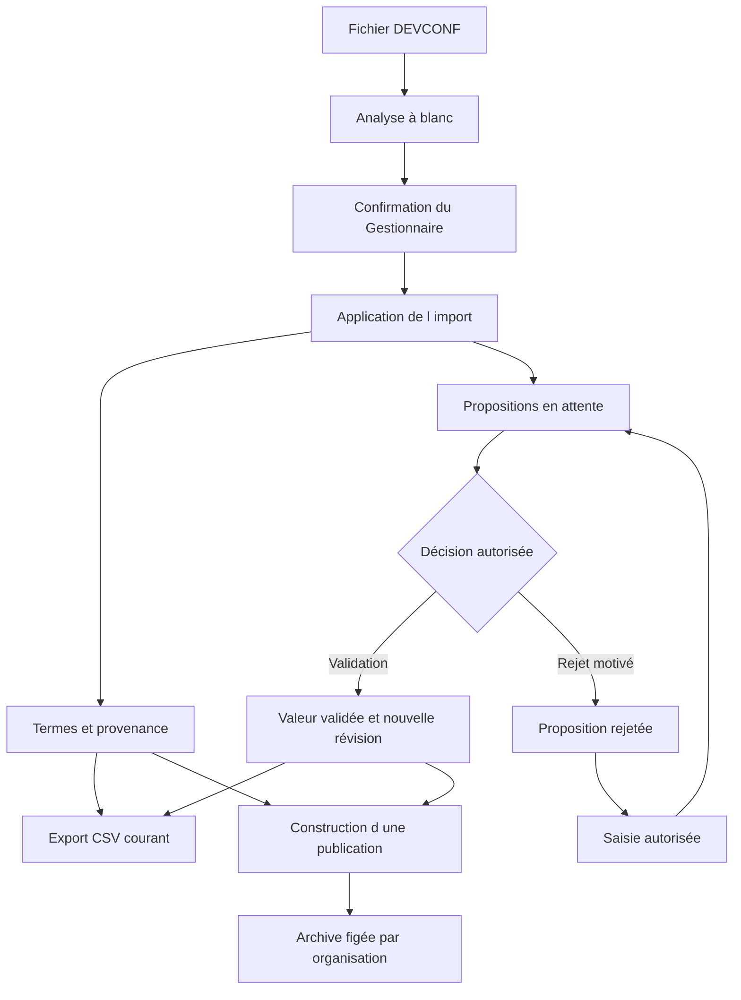

# PRD fonctionnel de myABI Translate

État de l’application au 13 octobre 2026, établi sur le code du dépôt à la révision `346df90`. Ce PRD décrit le produit implémenté, ses utilisateurs et ses règles actuelles. Il ne définit ni cible future ni engagement de livraison. Les comportements conditionnels sont indiqués avec leur condition ; cet état du code ne présume pas de la configuration d’un serveur déployé.

## Finalité du produit

myABI Translate est le référentiel partagé des traductions myABI pour les organisations membres de l’ARGE-ABI. Il permet de recevoir des fichiers DEVCONF, de retrouver leurs termes, de proposer et faire examiner des traductions, puis de produire des fichiers destinés aux organisations.

La couverture se limite aux traductions présentes dans les fichiers DEVCONF pris en charge. Les fichiers NLS (CSV) ne regroupent pas toutes les traductions de myABI : les traductions des masques d’écran sont stockées dans la base de données de myABI et concernent des termes distincts de ceux du type `Form` déjà pris en charge. Ces termes de masques d’écran et les autres traductions absentes des fichiers ne peuvent pas être gérés par myABI Translate ; l’outil ne les lit ni ne les modifie directement dans cette base.

Le travail s’organise autour de trois valeurs distinctes : la valeur du fichier importé, la proposition en attente et la valeur validée. Une importation ou une saisie ne remplace pas directement une traduction validée. Les décisions, révisions et publications permettent de retracer les changements.

### Vocabulaire métier

| Notion | Sens dans l’application |
| --- | --- |
| Terme | Élément identifié par un type DEVCONF et une clé exacte, sans organisation propriétaire. |
| Attribut | Champ traduisible d’un terme ; certains formats en comportent plusieurs. |
| Cellule de traduction | Valeur d’un attribut dans une langue pour un terme donné. |
| Proposition | Valeur soumise à décision, avec auteur, état et provenance éventuelle d’import. |
| Révision | État conservé d’un terme, notamment lors d’un import qui le crée ou le modifie, d’une validation ; les anciennes décisions de périmètre restent dans l’historique. |
| Version myABI | Référence de version avec numéro, date de sortie et statut, à laquelle sont rattachés imports et publications. |
| Publication | Ensemble de fichiers figés à sa construction, avec une archive et une traçabilité par organisation destinataire. |

## Documents fonctionnels associés

| Document | Contenu |
| --- | --- |
| [Personas](personas.md) | Profils d’usage fondés sur les cinq rôles et matrice des droits. |
| [Cas d’utilisation](cas-utilisation.md) | Déclencheurs, préconditions, actions, résultats et exceptions. |
| [Exigences fonctionnelles](exigences-fonctionnelles.md) | Règles observables de l’existant, identifiées par domaine. |
| [Parcours UI et UX](parcours-ui-ux.md) | Écrans, navigation, formulaires, retours et limites des parcours disponibles. |

Les [spécifications historiques](../../specifications-fonctionnelles-referentiel-traductions-arge-abi.md) restent un document distinct. Les présents fichiers décrivent l’existant vérifié dans le code. L’[annexe DEVCONF](../technique/formats-devconf.md) détaille les formats et [DESIGN.md](../../DESIGN.md) décrit la référence visuelle.

## Utilisateurs et accès

Chaque compte nominatif possède une organisation, un ou plusieurs rôles et des langues associées aux rôles. Les profils d’usage sont :

- **Lecteur** : consulter les termes accessibles et télécharger les publications de son organisation.
- **Traducteur** : proposer des valeurs dans ses langues sur tous les termes courants.
- **Validateur** : examiner et décider les propositions dans ses langues, toutes organisations confondues ; il peut aussi y proposer des valeurs.
- **Gestionnaire** : gérer les imports, les versions, les exports et les publications ; proposer et valider dans toutes les langues prises en charge.
- **Administrateur** : gérer les organisations et les comptes, et consulter l’audit. Ce rôle seul ne confère pas les droits métier du Gestionnaire.

Tous les utilisateurs autorisés consultent le catalogue courant commun. Les organisations rattachent les comptes, identifient les origines historiques des contributions et les destinataires des fichiers ; elles ne définissent aucune variante de traduction.

L’accès passe par une connexion nominative. Les comptes techniques ne se connectent pas. Un compte désactivé, temporairement verrouillé, rattaché à une organisation inactive ou encore soumis à une invitation non acceptée ne peut pas se connecter.

## Périmètre fonctionnel

| Domaine | Capacités présentes | Résultat pour l’utilisateur |
| --- | --- | --- |
| Accès et profil | Invitation, activation administrative sans courriel, connexion, récupération et changement de mot de passe, second facteur conditionnel, langue et notifications. | Accéder au référentiel avec les droits du compte et gérer ses préférences. |
| Tableau de bord | Comptages des termes accessibles, propositions en attente, termes à revoir et propositions anciennes ; imports récents pour le Gestionnaire. | Identifier le travail disponible dans le catalogue partagé. |
| Catalogue | Recherche, filtres, pagination, affichage des valeurs en vigueur et des propositions, fiche détaillée. | Retrouver un terme et comprendre son état. |
| Contribution | Proposition individuelle ou depuis plusieurs lignes du catalogue, correction autorisée, nouvelle proposition après rejet, reprise d’une ancienne valeur. | Soumettre explicitement une traduction à décision. |
| Validation | Décision individuelle, décision sur sélection, validation de tous les résultats filtrés, validation initiale d’un import après aperçu. | Faire entrer les valeurs acceptées dans le référentiel validé. |
| Imports | Téléversement d’un fichier, analyse à blanc, confirmation d’application, rapport, original et suivi. | Alimenter les termes, leur provenance et leurs propositions. |
| Versions | Création avec numéro, date et statut ; changement de statut depuis la liste des publications. | Rattacher les imports et publications à une version myABI. |
| Exports | Téléchargement d’un CSV DEVCONF pour un type, une version admissible et une organisation active. | Obtenir un fichier calculé sur les valeurs courantes. |
| Publications | Génération en arrière-plan, fichiers figés par destinataire, manifeste, téléchargement ZIP, retrait motivé et reprise après échec. | Disposer d’un catalogue daté qui reste identique après les changements ultérieurs. |
| Administration et audit | Comptes, rôles, langues, organisations, sessions, déverrouillage, journal filtrable et export CSV. | Administrer les accès et retracer les actions. |

### Langues et familles de contenu

L’interface de l’application Laravel existe en allemand, français et italien. Les langues de traduction sont l’allemand, le français, l’italien et l’anglais, sous réserve que le format de la ligne comporte une colonne correspondante. La langue de l’interface et la langue de travail du catalogue sont deux choix distincts.

| Type DEVCONF | Contenu éditable |
| --- | --- |
| mRic-js | Un libellé par terme. |
| MonoMOT | Un libellé par terme. |
| Server | Un libellé par terme. |
| Form | Un libellé, avec les langues déclarées dans les couples langue et traduction. |
| Incident Workflow | Un libellé, avec les langues déclarées dans les couples langue et traduction. |
| Law Catalog | Cause Text, Short Justification et Legal Remedies. |
| Incident code | TEXT, SHORTTEXT, ALTERNATIVE_TEXT_1, ALTERNATIVE_TEXT_2, ADDINFO, ADDINFO1 à ADDINFO6 et USAGE_POLICY. |

La référence affichée provient de l’allemand lorsqu’il est disponible selon le format. Les publications préservent les colonnes de référence source ; les cellules cibles sont déterminées par leur colonne, même lorsque la langue cible est de et que Default Language vaut fr. Les formats NLS et Law disposent d’un repli sur leurs champs de référence ; Form et Incident Workflow utilisent leur champ `Default Label`. L’étiquette d’interface `de_CH` ne constitue donc pas une détection de la langue réelle de chaque référence.

## Cycle fonctionnel

Le diagramme montre les dépendances de contenu. La génération d’une sortie reste soumise aux contrôles de version, de source et d’identité. L’export conserve le repli importé pour une cellule non validée ; la publication laisse cette cellule cible vide ; les propositions en attente ne servent pas de remplacement.

### Règles qui structurent le produit

1. **Décision explicite.** Les imports créent des propositions, notamment pour les traductions non allemandes non vides qui diffèrent de la valeur validée. Ils ne les valident pas automatiquement.
2. **Séparation de l’auteur et du validateur.** Un utilisateur ne valide pas sa propre proposition, sauf Gestionnaire ayant coché la dérogation. Cette dérogation est auditée ; le code actuel n’exige pas de motif textuel pour elle. Un rejet exige un motif.
3. **Concurrence contrôlée.** Une action fondée sur une proposition modifiée entre-temps est refusée. Les opérations de masse sont liées au catalogue examiné et peuvent s’arrêter si ce catalogue change.
4. **Identités conservées.** Le type et la clé exacte déterminent l’identité. La casse et les espaces des clés restent significatifs. Les collisions sont signalées et bloquent les sorties concernées.
5. **Source et validation séparées.** Une modification de la référence lors d’un import récent conserve les valeurs validées et marque celles de l’attribut concerné « à revoir ». Leur confirmation lève ce marquage sans créer de révision supplémentaire.
6. **Absence sans suppression.** L’absence d’un terme dans un nouvel import ne le supprime pas et ne le rend pas automatiquement obsolète.
7. **Publication figée à sa construction.** La demande est mise en attente ; la construction capture les valeurs et révisions alors courantes. Une fois publiée, l’archive n’est plus reconstruite à partir des modifications ultérieures.
8. **Sorties contrôlées.** L’export inclut tous les termes connus du type, depuis plusieurs sources si nécessaire, avec valeur validée ou repli importé. La publication inclut les termes au moins partiellement validés et laisse vides les cellules cibles sans validation. Une source technique manquante ou ambiguë bloque le fichier ; l’organisation ne filtre pas les termes.

### Export et publication

| Propriété | Export simple | Publication |
| --- | --- | --- |
| Déclencheur | Formulaire Exports du Gestionnaire. | Formulaire Publications du Gestionnaire. |
| Choix à l’écran | Type, version, organisation active. | Version, un ou plusieurs types, note facultative. |
| Destinataires | Une organisation choisie. | Toutes les organisations actives par défaut dans le formulaire actuel. |
| Résultat | Un CSV DEVCONF téléchargé. | Un ZIP par organisation contenant les CSV et les manifestes de catalogue et de révisions. |
| Sélection | Tous les termes courants connus du type, sans restriction de provenance. | Termes ayant au moins une cellule cible validée, autres cellules cibles vides. |
| Moment des valeurs | Génération de l’export. | Construction de la publication en arrière-plan. |
| Conservation dans l’historique des publications | Aucune publication créée. | Publication numérotée, consultable et retirable avec motif. |
| Accès au téléchargement | Gestionnaire. | Gestionnaire ou utilisateur de l’organisation destinataire. |

Le serveur accepte une liste explicite de destinataires à la création d’une publication, mais le formulaire ne propose pas ce choix. Une publication retirée garde ses fichiers ; son téléchargement utilise un choix explicite transmis par le lien de sa fiche.

## États et indicateurs disponibles

Les propositions ont trois états : en attente, validée ou rejetée. Les termes exposent les états manquant, validé, publié, à revoir et obsolète, ainsi qu’un filtre de propositions en attente. Les attributs d’un même terme peuvent présenter des états différents ; la ligne principale du catalogue affiche le premier attribut du format, alors que les filtres d’état peuvent correspondre à un autre attribut.

Les imports exposent l’attente, l’analyse, le résultat analysé, l’attente d’application, l’application, le résultat appliqué, l’échec et l’annulation. Les publications exposent l’attente, la construction, la publication, l’échec et le retrait. Les validations en arrière-plan exposent des compteurs de traitement et d’exclusion.

Le tableau de bord compte les propositions âgées d’au moins 30 jours depuis leur création. Le résumé quotidien calcule son compteur de propositions anciennes depuis leur dernière modification. Les publications fournissent une couverture par langue distinguant cellules validées et cellules cibles vides. Aucun objectif chiffré de performance ou d’adoption n’est ajouté à ces indicateurs.

## Conditions de fonctionnement visibles

- Le second facteur dépend d’un réglage global. Lorsqu’il est activé, il est obligatoire pour les Validateurs, Gestionnaires et Administrateurs, et facultatif pour les autres comptes.
- Les imports, constructions de publications et validations en arrière-plan dépendent du traitement des opérations en attente par le serveur. L’écran web seul ne les exécute pas.
- Un traitement lourd peut suspendre temporairement les écritures. L’interface affiche cette situation ; une capacité de stockage insuffisante peut bloquer une opération.
- Le résumé quotidien est facultatif, envoyé dans la langue du compte, uniquement s’il contient des compteurs non nuls et si le service de courriel et le planificateur sont opérationnels. Sa programmation est à 07:00, Europe/Zurich.
- La recherche par expression régulière appartient au Gestionnaire et dépend de MariaDB ou MySQL.

## Limite du composant navigateur

Le dépôt contient aussi [MyAB Translation Inspector](../../extension/README.md), un composant navigateur séparé. Son API Laravel version 2 retrouve les cellules du catalogue commun avec un jeton personnel, distingue valeur importée et validée et préserve les ambiguïtés. Le retour de correspondance facultatif ne modifie pas le workflow. Sa [mise en œuvre](../technique/api-extension-implementation.md) décrit la projection, la connexion et la recette ; une API factice reste disponible uniquement en mode de test explicite.

## Sources de référence de cet état

- Accès et droits : [routes web](../../routes/web.php), [routes d’authentification](../../routes/auth.php), [User](../../app/Models/User.php), [Term](../../app/Models/Term.php).
- Catalogue et décisions : [TermController](../../app/Http/Controllers/TermController.php), [WorkflowService](../../app/Services/WorkflowService.php), [ProposalFilter](../../app/Services/ProposalFilter.php).
- Entrées et sorties : [ImportService](../../app/Services/ImportService.php), [DevconfExportService](../../app/Services/DevconfExportService.php), [PublicationService](../../app/Services/PublicationService.php), [formats](../../app/Domain/Devconf/FormatRegistry.php).
- Écrans : [vues Blade](../../resources/views), [comportements du navigateur](../../public/js/app.js).
- Les exigences détaillées renvoient aux fichiers de tests existants comme points de contrôle, sans présenter leur présence comme une exécution de recette.
