# Manuel utilisateur de myabi-translate

myabi-translate permet de rechercher les termes myABI, de proposer des traductions et de suivre leur validation. Les termes et les traductions validées sont communs aux organisations. Votre organisation identifie votre contribution et les publications qui vous sont destinées.

Les captures utilisent uniquement des données fictives. Le même exemple accompagne les parcours : les commandes d’ouverture, d’enregistrement, de fermeture et d’aide d’un dossier.

## 1. Se connecter et comprendre les rôles

Objectif : accéder aux fonctions autorisées pour votre compte.

1. Sélectionnez **FR** dans **Langue de l’interface**.
2. Renseignez **Adresse e-mail** et **Mot de passe**.
3. Cliquez sur **Se connecter**.
4. Fournissez le second facteur si l’application le demande.

Résultat : le tableau de bord et les menus accessibles s’affichent.

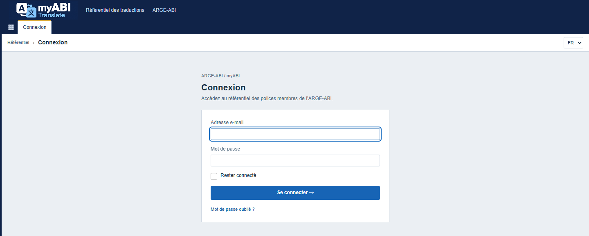

Figure 1 — Connexion à l’application.

| Rôle | Actions principales |
| --- | --- |
| Lecteur | Consulter les termes et les publications accessibles. |
| Traducteur | Envoyer des propositions dans ses langues autorisées. |
| Validateur | Proposer et décider dans ses langues autorisées. |
| Gestionnaire | Valider et organiser les groupes, campagnes, imports, exports et publications. |
| Administrateur | Gérer les comptes et les organisations. |

Les rôles peuvent se cumuler. Le rôle Administrateur seul ne donne aucun droit de traduction ou de validation. Les menus et les actions dépendent de ces droits.

Le lien **Mot de passe oublié ?** permet de demander une réinitialisation. Utilisez **Déconnexion** pour fermer votre session.

## 2. Rechercher un terme et utiliser les filtres

Objectif : retrouver les termes utiles dans la langue cible choisie.

1. Ouvrez **Traductions**.
2. Sélectionnez **Français**, **Italien**, **Allemand** ou **Anglais** dans la barre des langues.
3. Saisissez une clé ou un texte, par exemple « dossier ».
4. Choisissez les filtres utiles : **Type**, **Version myABI**, **État**, **Groupe de termes** ou **Campagne**.
5. Cliquez sur **Filtrer**.

Résultat : le tableau affiche les termes correspondant aux critères.

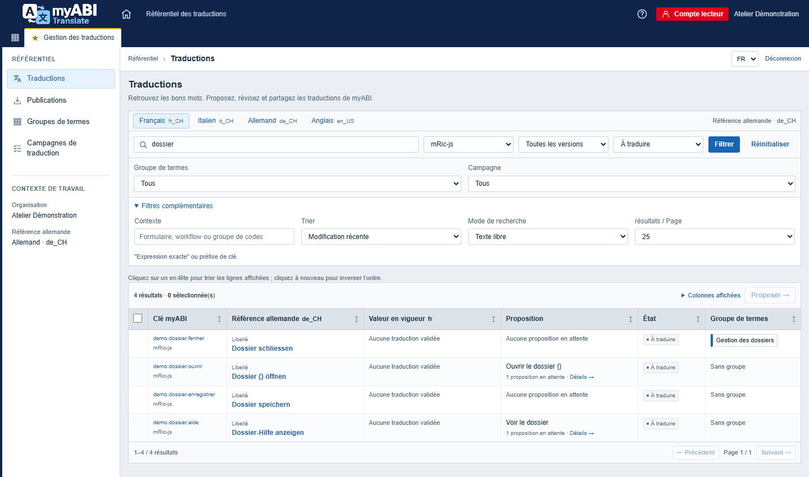

Figure 2 — Recherche dans le catalogue commun.

**Sans groupe** retrouve les termes non classés. **Filtres complémentaires** donne accès au contexte et aux options de recherche. **Réinitialiser** efface les critères et conserve la langue cible.

La langue cible est indépendante de la langue de l’interface. Vous pouvez travailler en italien avec des menus français.

## 3. Consulter une fiche et son historique

### Lire les valeurs et leur provenance

Objectif : comprendre la référence, la traduction actuelle et les contributions existantes.

1. Cliquez sur une **Clé myABI** ou une **Référence allemande** dans le catalogue.
2. Consultez la **Valeur en vigueur** et son état.
3. Repérez les **Variables à conserver**, comme `{}`.
4. Dépliez **Valeurs importées** pour consulter les textes d’origine.
5. Parcourez **Propositions** pour lire les contributions et les décisions.

Résultat : vous distinguez la valeur validée des propositions encore en attente.

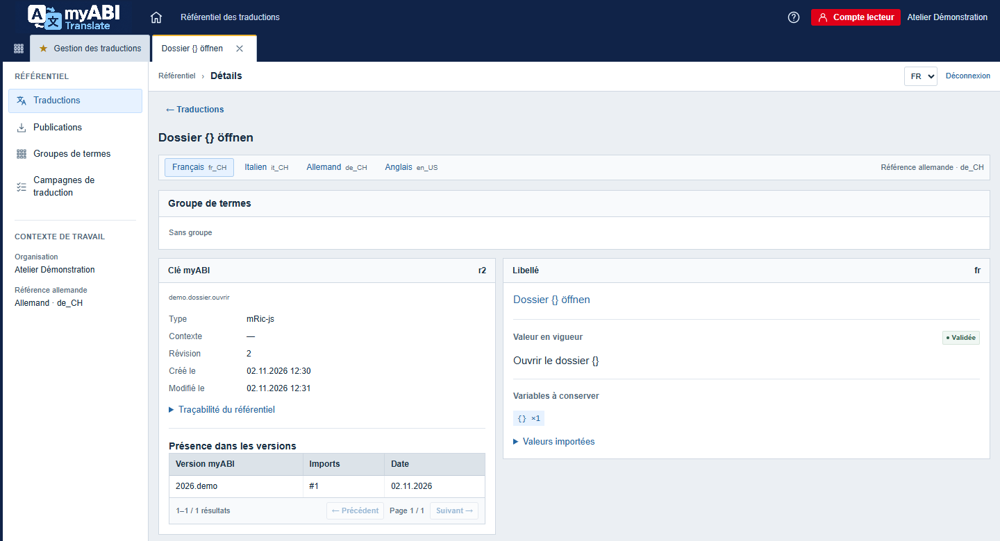

Figure 3 — Référence allemande et traduction française validée.

**Présence dans les versions** indique les imports associés au terme. Certains formats comportent plusieurs attributs. Examinez chaque panneau concerné.

### Comparer deux révisions

Objectif : comprendre l’évolution d’un terme.

1. Descendez jusqu’à **Révisions**.
2. Choisissez **Révision de départ** et **Révision d’arrivée**.
3. Cliquez sur **Comparer**.
4. Consultez **Historique du terme** pour identifier les actions et leurs auteurs.

Résultat : les valeurs des deux révisions sont présentées côte à côte.

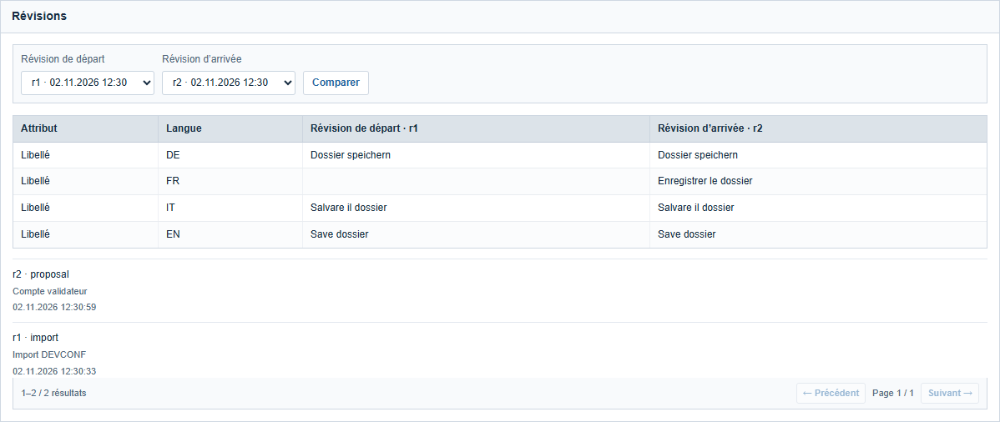

Figure 4 — Apparition de la traduction française dans la révision suivante.

Pour un contributeur autorisé, **Reprendre cette révision** prépare une nouvelle proposition. Cette action ne rétablit pas directement une ancienne valeur validée.

## 4. Proposer une traduction

Objectif : soumettre une traduction à examen.

Rôle requis : Traducteur, Validateur ou Gestionnaire autorisé dans la langue concernée.

1. Ouvrez la fiche du terme.
2. Choisissez la langue cible.
3. Renseignez **Nouvelle proposition**, par exemple « Enregistrer le dossier ».
4. Conservez toutes les variables de la référence, avec leur nombre d’occurrences.
5. Cliquez sur **Proposer**.

Résultat : la contribution reçoit l’état **Proposée**.

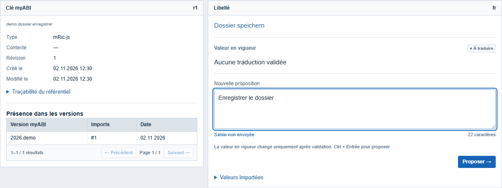

Figure 5 — Saisie d’une proposition française avant son envoi.

Une proposition envoyée n’est pas encore une traduction validée. La valeur en vigueur reste inchangée. Le catalogue permet aussi une saisie rapide lorsqu’aucune proposition n’est déjà en attente sur l’attribut affiché.

**Saisie non envoyée** signale un texte encore local à la page. Envoyez vos saisies avant de quitter l’écran. Une variable manquante bloque l’envoi.

Vous pouvez utiliser **Corriger la proposition** sur une contribution en attente qui vous appartient. Après un rejet, **Corriger ce rejet par une nouvelle proposition** conserve la décision précédente et prépare un nouvel envoi.

## 5. Participer à une campagne

Objectif : traiter les termes d’un travail collectif dans une langue définie.

Rôle requis : personne assignée, autorisée à traduire dans la langue de la campagne.

1. Ouvrez **Campagnes de traduction**, puis la campagne concernée.
2. Lisez **Description et consignes** et l’**Échéance**.
3. Repérez les termes **À traiter**.
4. Dépliez **Proposer**, saisissez le texte et cliquez sur **Proposer**.
5. Suivez le **Traitement dans la campagne**.

Résultat : le terme passe à **Proposition envoyée** et reste soumis à validation.

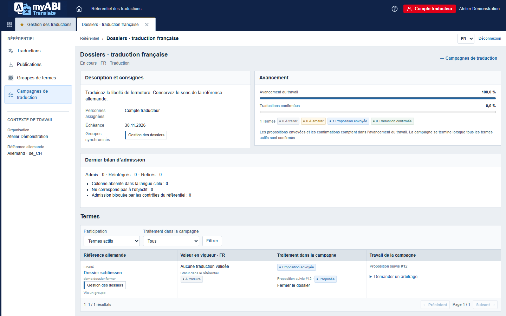

Figure 6 — Travail envoyé et traductions confirmées sont deux indicateurs distincts.

Un avancement de 100 % ne signifie pas que toutes les traductions sont validées. La campagne devient **Terminé** lorsque tous ses termes actifs sont confirmés. **Demander un arbitrage** permet de signaler une difficulté avec un motif.

## 6. Valider ou rejeter une proposition

Objectif : décider quelles propositions deviennent les traductions en vigueur.

Rôle requis : Validateur dans la langue concernée ou Gestionnaire.

1. Ouvrez **Validation** et choisissez la langue autorisée.
2. Filtrez les propositions à examiner.
3. Comparez la référence, la valeur en vigueur et la proposition.
4. Cochez les lignes retenues.
5. Choisissez **Valider** ou **Rejeter** dans **Décision**.
6. Pour un rejet, renseignez **Motif**.
7. Cliquez sur **Envoyer** et confirmez.

Résultat : la proposition devient **Validée** ou **Rejetée**.

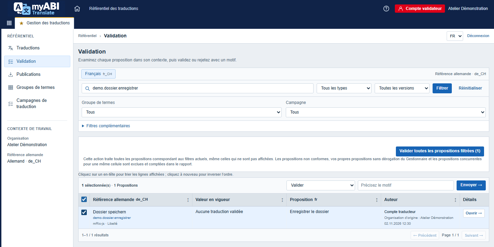

Figure 7 — Décision sur une sélection de propositions.

Une validation crée une révision. Un rejet conserve la valeur en vigueur.

Pour examiner une proposition individuellement, cliquez sur **Ouvrir**. Dans **Propositions**, utilisez **Valider** ou renseignez **Motif du rejet** et **Précisez le motif**, puis cliquez sur **Rejeter**.

Un Validateur ne peut pas valider sa propre proposition. Le Gestionnaire dispose d’une case **Dérogation du Gestionnaire** pour ce cas.

**Valider toutes les propositions filtrées** traite l’ensemble des résultats, au-delà des lignes cochées. Examinez le périmètre annoncé et le bilan des exclusions.

## 7. Organiser les groupes et les campagnes

Rôle requis : Gestionnaire.

### Classer les termes

Objectif : réunir des termes par sujet.

1. Dans **Groupes de termes**, cliquez sur **Créer un groupe**.
2. Renseignez **Titre**, **Description** et **Couleur**, puis cliquez sur **Enregistrer**.
3. Dans **Traductions**, cochez les termes et choisissez le groupe dans **Composer et classer la sélection**.
4. Cliquez sur **Affecter au groupe** et confirmez.

Résultat : les termes sont classés dans le groupe choisi.

### Préparer le travail collectif

Objectif : attribuer un ensemble de termes à des contributeurs.

1. Dans **Campagnes de traduction**, cliquez sur **Créer une campagne**.
2. Renseignez le titre, les consignes, la langue, l’objectif et l’échéance.
3. Choisissez les **Personnes assignées** et les **Groupes synchronisés**.
4. Cliquez sur **Enregistrer**, examinez le bilan d’admission, puis cliquez sur **Démarrer**.

Résultat : la campagne passe de **À faire** à **En cours**.

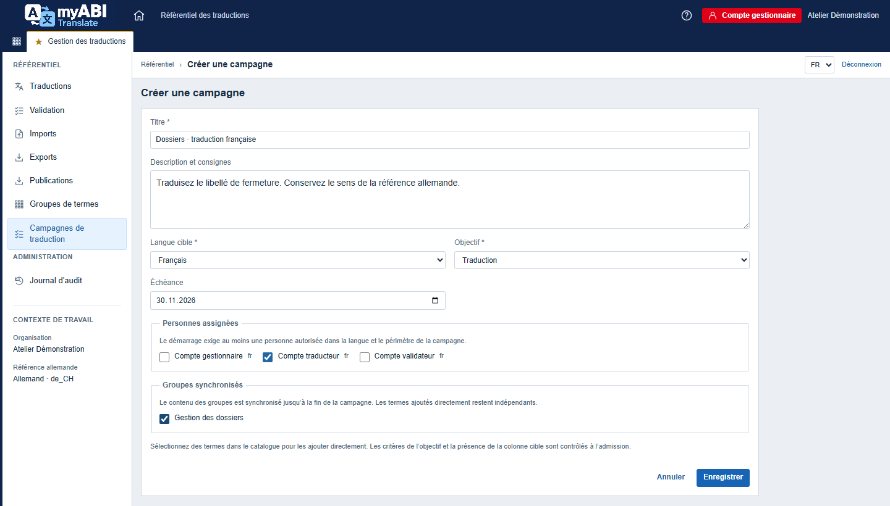

Figure 8 — Préparation d’une campagne de traduction.

Le démarrage exige au moins un terme actif et une personne autorisée. La première admission verrouille la langue et l’objectif. Les groupes restent synchronisés jusqu’à la fin de la campagne.

## 8. Importer un fichier DEVCONF

Objectif : intégrer un fichier source après contrôle.

Rôle requis : Gestionnaire.

1. Ouvrez **Imports**.
2. Choisissez **Version myABI**, **Type** et **Origine du fichier**.
3. Pour une origine organisationnelle, précisez l’**Organisation d’origine**.
4. Sélectionnez le fichier et cliquez sur **Analyser**.
5. Attendez **Analyse terminée**, puis examinez erreurs, avertissements et collisions.
6. Cliquez sur **Appliquer l’import** et confirmez.

Résultat : l’import **Appliqué** alimente les propositions admissibles.

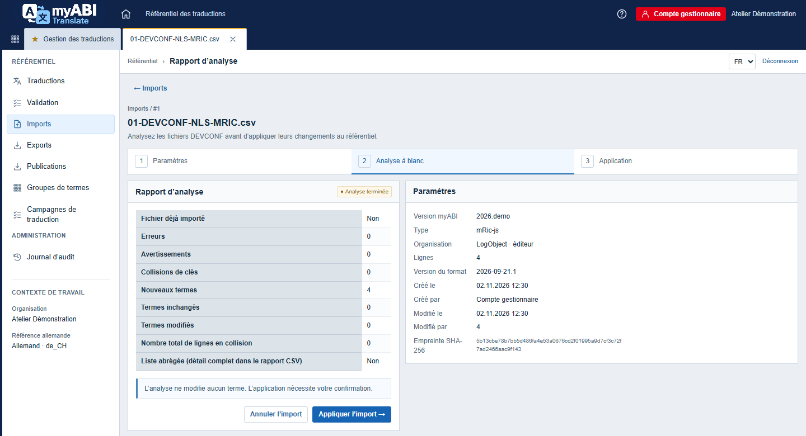

Figure 9 — Analyse à blanc avant application.

L’analyse ne modifie aucun terme. L’application de l’import ne valide pas les traductions. La validation reste une décision distincte.

Examinez les erreurs bloquantes avant de poursuivre. **Rapport CSV** fournit le détail des contrôles. Si aucune version n’existe, créez-la dans **Publications**, avec **Créer la version**, avant l’import.

## 9. Exporter et télécharger une publication

### Télécharger un export courant

Objectif : obtenir le CSV DEVCONF actuel d’un type.

Rôle requis : Gestionnaire.

1. Ouvrez **Exports**.
2. Choisissez **Type** et **Version myABI**.
3. Cliquez sur **Télécharger le CSV**.

Résultat : un fichier contient les termes connus du type et toutes les langues.

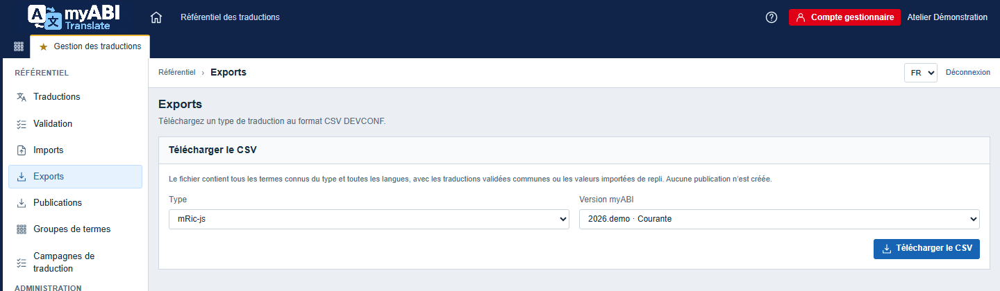

Figure 10 — Téléchargement du CSV courant.

L’export utilise les traductions validées et les valeurs importées de repli pour les cellules non validées. Il ne crée aucune publication.

### Télécharger un ensemble figé

Objectif : récupérer les fichiers d’une publication destinée à votre organisation.

1. Ouvrez **Publications**.
2. Ouvrez la publication accessible et vérifiez l’état **Publiée**.
3. Consultez sa note et sa couverture.
4. Cliquez sur **Télécharger** dans le panneau de votre organisation.

Résultat : vous recevez une archive ZIP contenant les fichiers figés.

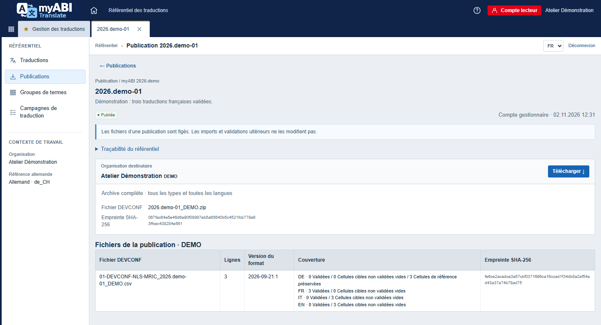

Figure 11 — Publication accessible au compte lecteur destinataire.

Le Gestionnaire crée une publication en choisissant une version et les types, puis **Publier**. Le formulaire cible les organisations actives. La construction peut prendre du temps.

La publication retient les termes ayant au moins une traduction validée. Les autres cellules cibles restent vides. Les références sont préservées. Les décisions ultérieures ne modifient pas les fichiers déjà figés.

## 10. Régler son profil et son affichage

Objectif : adapter vos préférences et vérifier vos droits.

1. Cliquez sur votre nom pour ouvrir **Mon profil**.
2. Consultez votre organisation et vos rôles.
3. Choisissez **Langue de l’interface**.
4. Réglez **Recevoir le résumé quotidien par e-mail**, puis cliquez sur **Enregistrer**.
5. Dans **Traductions**, utilisez **Colonnes affichées** pour afficher ou masquer **Clé myABI** et **État**.

Résultat : vos préférences sont enregistrées.

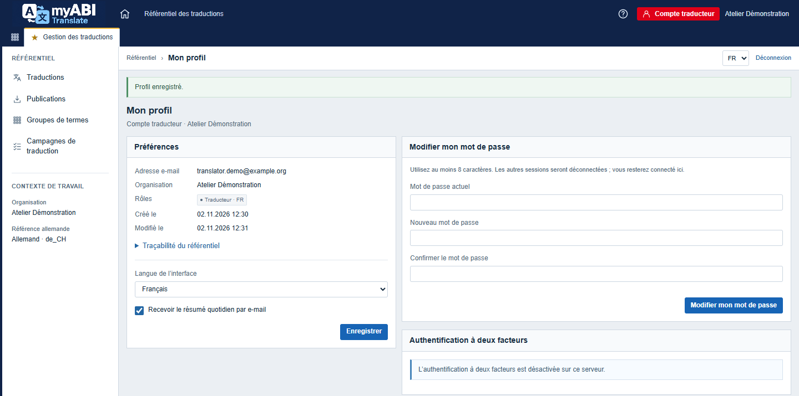

Figure 12 — Préférences du compte traducteur.

**Modifier mon mot de passe** exige le mot de passe actuel et la confirmation du nouveau. Les autres sessions sont déconnectées. Le résumé quotidien dépend du service d’envoi configuré.

## 11. Utiliser l’extension dans Chrome et Firefox

**MyAB Translation Inspector** retrouve dans le référentiel un texte affiché dans MyAB. Elle ne modifie pas MyAB. L’ouverture d’une fiche conserve les droits et les langues autorisées de votre compte.

Demandez au responsable le paquet correspondant à votre navigateur et les adresses de connexion. La configuration et l’utilisation sont identiques dans Chrome et Firefox.

### Installer dans Chrome

Objectif : rendre l’inspecteur disponible dans Chrome.

1. Décompressez le paquet Chrome fourni dans un dossier que vous conserverez.
2. Ouvrez `chrome://extensions` et activez **Mode développeur**.
3. Cliquez sur **Charger l’extension non empaquetée**.
4. Sélectionnez le dossier contenant `manifest.json`.
5. Épinglez **MyAB Translation Inspector** dans la barre d’outils.

Résultat : l’extension apparaît parmi les extensions installées.

Le [guide officiel de Chrome](https://developer.chrome.com/docs/extensions/get-started/tutorial/hello-world?hl=fr#load-unpacked) décrit ce chargement local.

### Installer dans Firefox

Objectif : rendre l’inspecteur disponible dans Firefox.

Pour une installation durable, demandez au responsable un paquet `.xpi` signé par Mozilla. Le dossier Firefox non signé permet seulement un essai temporaire selon la procédure suivante.

1. Décompressez le paquet Firefox fourni.
2. Ouvrez `about:debugging#/runtime/this-firefox`.
3. Cliquez sur **Charger un module complémentaire temporaire…**.
4. Sélectionnez `manifest.json` dans le dossier Firefox.

Résultat : l’extension reste installée jusqu’au redémarrage de Firefox.

Mozilla précise les conditions de [l’installation temporaire](https://extensionworkshop.com/documentation/develop/temporary-installation-in-firefox/) et de [la signature des modules](https://support.mozilla.org/fr/kb/signature-modules-complementaires-firefox).

### Configurer l’accès au référentiel

Objectif : relier l’extension à votre compte personnel.

1. Dans **Mon profil**, repérez **Extension navigateur**.
2. Renseignez **Nom du jeton** et **Durée en jours**, puis cliquez sur **Créer un jeton**.
3. Si une confirmation est demandée, confirmez votre mot de passe, puis reprenez la création depuis le profil.
4. Copiez immédiatement le jeton affiché. Dans l’extension, utilisez **Ouvrir les paramètres** et collez-le dans **Token / clé API**. Le référentiel ne l’affichera plus.
5. Dans **Service de recherche**, choisissez **Référentiel réel (contrat v2)**.
6. Renseignez l’**URL de l’API** fournie et les **Domaines MyAB autorisés**, un par ligne.
7. Choisissez **Français** pour **Langue de l’interface** et vérifiez **Langue du texte inspecté**.
8. Cliquez sur **Enregistrer**, acceptez les autorisations demandées, puis utilisez **Tester la connexion**.

Résultat : l’extension peut rechercher avec les droits de votre compte.

L’adresse HTTPS de l’API se termine par `/api/browser-extension`. **Test uniquement : résultats fictifs** ne consulte pas votre référentiel. La langue du panneau est indépendante de celle du texte recherché et de la langue cible de la fiche.

### Retrouver une traduction depuis MyAB

Objectif : ouvrir la fiche correspondant à un libellé affiché dans MyAB.

1. Rechargez l’onglet MyAB après la configuration.
2. Cliquez sur l’icône de l’extension et activez **Mode inspecteur**. Le raccourci par défaut est **Alt + Maj + M**.
3. Maintenez **Alt** et cliquez sur le texte, par exemple « Enregistrer le dossier ».
4. Examinez les correspondances, puis cliquez sur **Ouvrir la traduction**.

Résultat : la fiche s’ouvre dans le référentiel, avec votre connexion habituelle.

Si plusieurs correspondances sont proposées, comparez leur clé, leur référence et leur attribut. **Rechercher manuellement dans l’application** permet de poursuivre la recherche. **Copier la clé** permet de transmettre l’identifiant du terme.

**Échap** ferme le panneau. Pour arrêter l’inspection, désactivez **Mode inspecteur**. Une proposition envoyée depuis la fiche suit la validation habituelle. **Signaler cette correspondance comme correcte**, lorsqu’il est disponible, ne valide aucune traduction.

### Renouveler ou retirer l’accès

Objectif : remplacer un jeton expiré ou supprimer un accès.

1. Créez un nouveau jeton dans **Mon profil**.
2. Remplacez le jeton dans les paramètres de l’extension et cliquez sur **Enregistrer**.
3. Dans **Extension navigateur**, cliquez sur **Révoquer** pour l’ancien jeton.

Résultat : l’ancien jeton ne permet plus d’interroger le référentiel.

Un jeton expire au plus tard après 30 jours. **Session du navigateur uniquement (à ressaisir)** impose de le saisir de nouveau après fermeture du navigateur. Ne partagez pas votre jeton.

En cas de refus d’authentification, vérifiez le jeton. En cas d’accès refusé, vérifiez les droits indiqués par le message. Pour un domaine non autorisé, utilisez **Ouvrir les paramètres**, vérifiez le domaine, enregistrez et rechargez MyAB.
